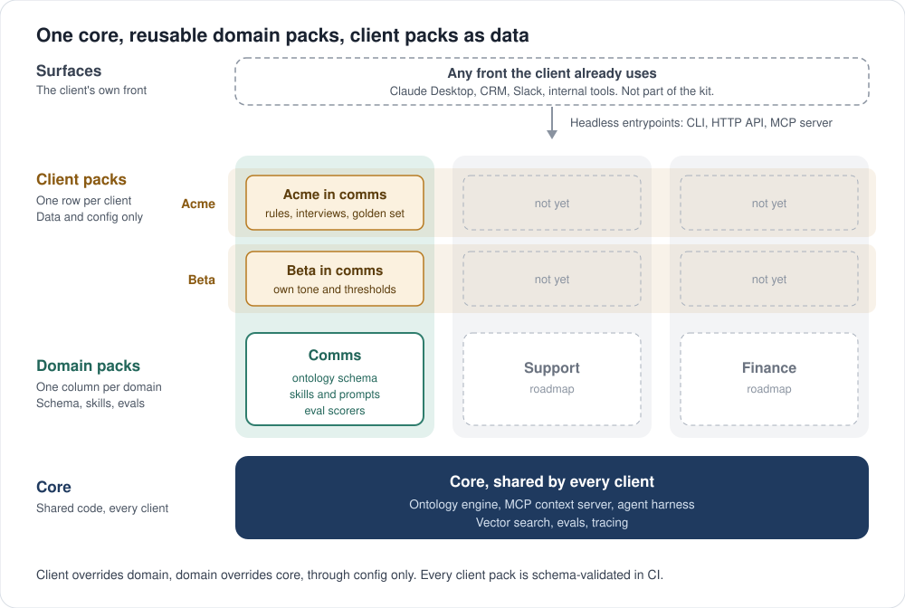
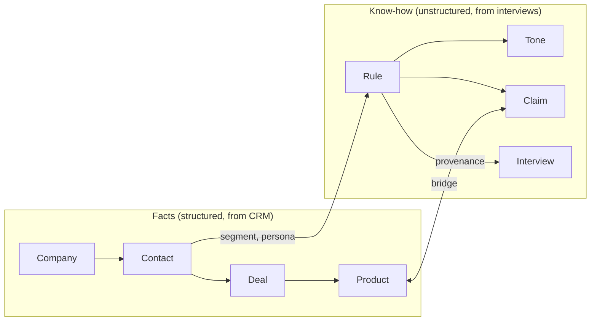
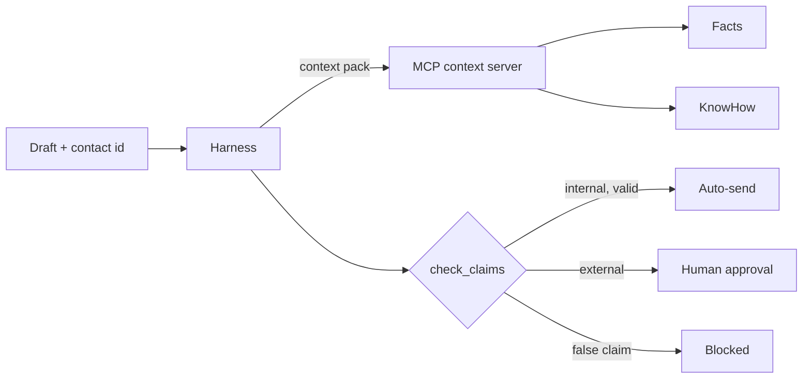

<p align="center">
  <picture>
    <source media="(prefers-color-scheme: dark)" srcset="docs/brand/logo-dark.svg">
    
  </picture>
</p>

<h2 align="center">Grounded AI on top of any SaaS, client after client.</h2>

<p align="center">An FDE deployment kit: one reusable core, a client pack per client, a 5-day playbook to fill it.</p>

Most AI deployments restart from scratch at every client: business facts live in the CRM, the know-how lives in people's heads, there is no shared harness and no evals. POCs work once and never scale.

This kit separates what never changes (the **core**), what is reusable per business domain (**domain packs**), and what is specific to each client (**client packs**). An FDE team ships a new client by filling a client pack through a 5-day playbook, not by writing new code.

> Demo use case: **email harmonization** on top of a CRM (HubSpot, Salesforce, Pipedrive...). Same core, two clients, same draft, two different compliant emails.

---

## The layers

<p align="center">
  
</p>

| Layer | Contains | Changes | Owned by | Code allowed |
|---|---|---|---|---|
| **Core** | Ontology engine, MCP context server, agent harness, eval runner, tracing | Rarely | Platform team | Yes |
| **Domain pack** | Domain ontology schema (facts + know-how concepts), skills and prompts, policy templates, eval scorers | Per new domain | FDE lead | Minimal |
| **Client pack** | Ontology instances, interviews, extracted rules, connector config, thresholds, golden set | Per client | FDE on the engagement | **No: data and config only** |

**Precedence:** `client > domain > core`, through config only. Every client pack is schema-validated in CI: if it does not validate, it does not ship.

---

## Two ontologies that talk



- **Facts** come from the client's systems (a CRM such as HubSpot or Salesforce, an ERP, a billing tool...). They are the source of truth for names, prices, deal stages.
- **Know-how** is extracted from expert interviews by Claude, reviewed by a human, and stored with its **provenance** (interview, quote) and **scope** (internal/external, segment, persona).
- **The bridge** (Product, Segment, Persona) lets the agent ask: *"what can I say to this contact, and how?"*

---

## How it runs



- **Headless:** CLI, HTTP API, webhooks from the client's SaaS (e.g. a CRM event). No UI.
- **Context sharing:** the same MCP server feeds the headless agent and Claude Desktop. Sales asks the ontology in Claude; the agent uses the exact same context.
- **Traceable:** every output cites the ontology nodes it used.

---

## Swap any SaaS

Every external system (CRM, email, vector store, model) sits behind a port. Each client pack picks its adapters in config:

```yaml
# client_packs/acme/config.yaml
crm: fixture        # CRM-shaped fixtures; live adapters (e.g. HubSpot, Salesforce) plug in here
messaging: console
vector_store: lancedb
model: claude       # or: replay (used by make demo)
domain: comms       # domain pack under domains/
```

To add Salesforce: write one adapter in `adapters/crm/`, pass `tests/contracts/`, change one line of config.

---

## Quickstart

```bash
make demo   # replays recorded runs, no API key needed
make live   # runs with ANTHROPIC_API_KEY
make evals  # runs the golden set for every client pack
```

Rewrite a draft for a contact, check it against the CRM, and route it (send, approval or blocked). Every run leaves a trace in `traces/`; external emails wait in a queue until a person approves them:

```bash
uv run groundwork harmonize --pack acme --contact acme-c-5 --channel external --draft draft.txt
uv run groundwork approvals list --pack acme
uv run groundwork approvals show <id> --pack acme      # read the email before deciding
uv run groundwork approvals approve <id> --pack acme   # records the answer and sends, once
```

With the default `replay`, only recorded cases run; `GROUNDWORK_MODEL=claude` (and `GROUNDWORK_EMBEDDING=voyage` for passages) runs live. The flow is in [docs/architecture.md](docs/architecture.md), the guarantees in [docs/security.md](docs/security.md).

---

## Evals: two levels before anything reaches a customer

| Level | What | When |
|---|---|---|
| **1. Automated** | Facts vs CRM, rule violations, tone (LLM judge) on a golden set per client | Every commit (CI) |
| **2. Human** | External emails go through an approval queue; approval rate is tracked | In production |

Results: see [`evals/report.md`](evals/report.md).

---

## Playbook: a new client in 5 days

Every step produces a **validated artifact** in `client_packs/<client>/`. The playbook is not a document next to the code: it is how the code gets its inputs.

| Day | Step | Artifact | Exit criteria |
|---|---|---|---|
| 1 | **Needs collection**: use case, users, internal vs external, systems, success metric, risks | `discovery.yaml` | Sponsor signs off the use case and the metric |
| 2 | **Facts mapping**: connect the CRM, map entities to the domain schema | `facts_mapping.yaml` | 100% of required fields mapped |
| 3 | **Know-how capture**: 3 to 5 expert interviews, extraction, human review | `interviews/`, `rules.yaml` | Every rule has provenance and scope |
| 4 | **Golden set**: 20 cases built with the experts, thresholds agreed | `golden.jsonl`, `thresholds.yaml` | Level-1 evals pass the thresholds |
| 5 | **Go-live**: policies, rollout plan, monitoring | `policies.yaml`, `go_live.md` | Internal auto-send live, external queue live |

Interview script and discovery canvas: [`playbook/`](playbook/).

---

## Repo layout

```
src/groundwork/
  core/          domain, ports, services (harness, context, policies, evals)
  adapters/      CRM, vector store, embeddings, model, replay...
  entrypoints/   CLI, HTTP API, MCP server
domains/comms/   ontology schema, skills, eval scorers
client_packs/    acme/, beta/: config, fixtures, interviews, rules, golden set
docs/            architecture, knowledge, MCP guide, evals, security, conventions, playbook, ADRs
tests/           unit, contracts, integration
```

All data in this repo is synthetic.

---

## Development

`make setup` then `make check`. To use a client's context from Claude Desktop, follow [`docs/mcp.md`](docs/mcp.md). Rules for humans and for Claude Code: [`CLAUDE.md`](CLAUDE.md) and [`docs/conventions.md`](docs/conventions.md).

---

## Design decisions

- **Client packs are data, not code.** That is what makes the 10th client cheaper than the 1st.
- **Shared context through MCP.** One source of truth for every agent and every human using Claude.
- **Evals before rollout, humans on external.** Trust is earned per client, not assumed.
- **Provenance everywhere.** Every rule traces back to an interview, every fact to the CRM.

---

## Origin

This pattern comes from deploying AI for manufacturers: structured production data on one side, plant experts' tacit know-how captured through LLM-assisted interviews on the other, validated in two levels before reaching production.

---

## License

MIT, see [LICENSE](LICENSE).
