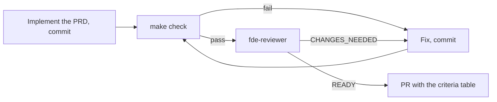

# Workflow: the verification loop

A change is done when `make check` is green and the `fde-reviewer` says READY. Run it with `/verify` in Claude Code.

Maximum 3 iterations, then stop and ask the human.

## Two layers
| Layer | What | Fails when |
|---|---|---|
| Deterministic (`make check`) | ruff, mypy strict, import-linter, unit, contract and integration tests, pack validation, coverage of core at least 90%, the evals report on replay (drift fails; unmet thresholds are printed, see docs/evals.md) | any check fails |
| `fde-reviewer` | Acts as the forward deployed engineer who deploys this next week: each PRD acceptance criterion verified with evidence, scope, usability, client-readiness, safety, honesty | a criterion is not met, or something would hurt in front of a client |

The deterministic layer is the floor; it carries the layer, test and lint rules a second code reviewer would only repeat. The reviewer runs on a different model than the one that writes the code (`model: opus` in its file, session on Sonnet), which gives some independence for free.

## Limits
- The reviewer is an LLM and can be wrong; the criteria table with evidence makes a lazy approval visible. The human still reads the diff and the table.
- Never change the reviewer file, thresholds or hooks to get green without a decision in a PR of its own.
